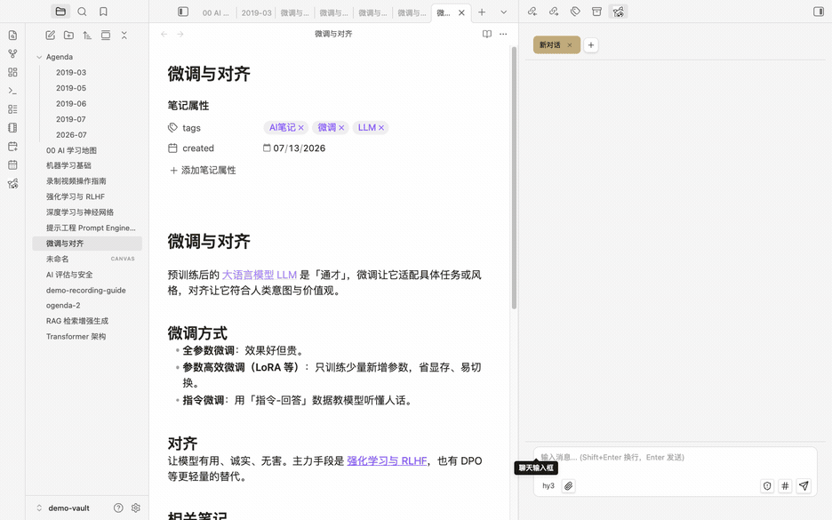
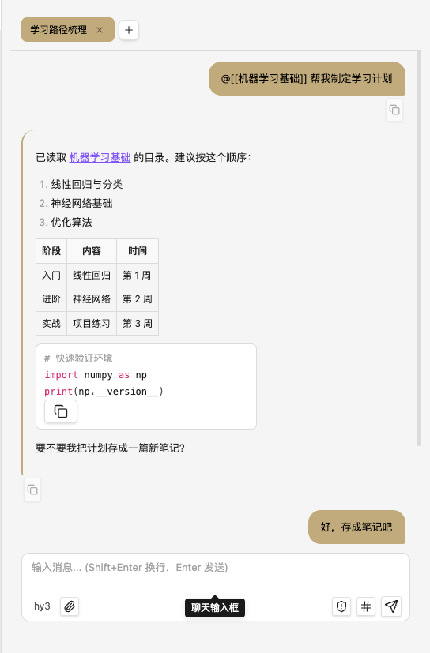
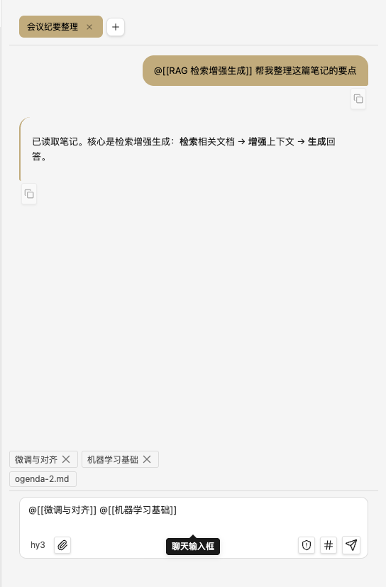

<h1 align="center">Workbuddian</h1>

<p align="center">
  <a href="https://github.com/jiang198012/workbuddian/releases/latest"></a>
  <a href="https://github.com/jiang198012/workbuddian/releases"></a>
  <a href="https://github.com/jiang198012/workbuddian/actions/workflows/ci.yml"></a>
  <a href="https://community.obsidian.md/plugins/workbuddian"></a>
  <a href="https://github.com/jiang198012/workbuddian/stargazers"></a>
  <a href="https://opensource.org/licenses/MIT"></a>
</p>

<p align="center">
  <a href="./README.md">简体中文</a> | <strong>English</strong>
</p>

<!--
project: Workbuddian
domain: Obsidian plugin / AI chat / local AI agent / Hermes Agent / CodeBuddy CLI / WorkBuddy
audience: Obsidian desktop users (Windows / macOS)
runtime: Obsidian 1.7.2+; CodeBuddy CLI, the WorkBuddy desktop app, or Hermes Agent
status: stable (2.6.24)
license: MIT
-->

**Workbuddian** is an Obsidian community plugin that brings the AI agent on your computer into your vault: **Hermes Agent**, or the **CodeBuddy CLI** (including the CLI bundled with the **WorkBuddy** desktop app). Chat next to your notes, reference notes and files with `@`, and approve each step the agent takes right in the chat bubble. Files it changes are shown as line-level diffs, and partial edits to vault files can be undone with one click.

> ⚠️ **Desktop only** (Windows / macOS), requires Obsidian 1.7.2+. Linux is not supported yet.

<p align="center">
  
</p>

<p align="center">
  
  
</p>

> **⭐ If Workbuddian is useful to you, please [star the repository](https://github.com/jiang198012/workbuddian) so more people can find it.**

## Features

| Feature | What it does |
| --- | --- |
| **Two backends** | The **CodeBuddy CLI** (the official CLI, or the one bundled with the WorkBuddy desktop app) and **Hermes Agent**. Both run over ACP with tool calls, approval cards, thinking, context usage and conversation forking. When no local Hermes CLI is available or a remote gateway is configured, Hermes switches to a chat-only lite mode |
| **Streaming chat** | In the sidebar or a full-width panel in the main area; collapsible thinking and tool-call cards; full Markdown rendering |
| **`@` references** | Attach notes, any file, subagents and MCP servers to one message; text selected in a note is sent as context automatically |
| **`/` commands and Skills** | Built-in commands, prompt templates, installed WorkBuddy / CodeBuddy Skills and custom commands in your vault; any other `/command` is passed to the CLI as is |
| **Approvals and permission modes** | Confirm file writes, edits, shell commands and MCP calls in the bubble; switch between three permission modes |
| **Line-level diffs and one-click undo** | Every edit shows the changed lines; partial edits to vault files can be undone with one click, with safety checks so later changes are not overwritten |
| **Inline edit** | Select text and let the AI rewrite it in place without leaving the note |
| **Conversation management** | Tabs, pinning, renaming, search, reopening with `/resume`, forking, separate conversations in two panels, automatic titles, export as notes |
| **Write back to notes** | Insert a reply or code block into the current note, or save it as a new note |
| **Images** | Paste or drop screenshots and let the model analyze them |
| **Templates and persistent instruction** | Start a chat from a writing, translation, code review or note-organizing template; the `#` persistent instruction is saved per conversation |
| **MCP and subagents** | Manage MCP servers visually, with the list and JSON kept in sync; define subagents in JSON |
| **Chinese / English UI** | Switch instantly; follows Obsidian by default |

## Installation

**Prerequisites**: Obsidian 1.7.2+ desktop, Windows or macOS, and one backend (see [Quick start](#quick-start)).

**From the community plugin directory (recommended)**

1. In Obsidian, open **Settings → Community plugins → Browse**.
2. Search for **Workbuddian**, select **Install**, then **Enable**.

You can also view it on the web: [community.obsidian.md/plugins/workbuddian](https://community.obsidian.md/plugins/workbuddian).

**Track the latest version with BRAT**: install the BRAT community plugin, choose *Add Beta Plugin*, enter `jiang198012/workbuddian`, then enable it under **Settings → Community plugins**.

**Manual installation**: download `main.js`, `manifest.json` and `styles.css` from the [latest release](https://github.com/jiang198012/workbuddian/releases/latest), put them in `.obsidian/plugins/workbuddian/` inside your vault, restart Obsidian and enable the plugin.

## Quick start

### Choose a backend

| Backend | Good for | Account and quota | Requires |
| --- | --- | --- | --- |
| Official CodeBuddy CLI (recommended) | The full CodeBuddy feature set | Your own CodeBuddy account | Node.js |
| WorkBuddy desktop app | You already use WorkBuddy and don't want another CLI | The account and quota signed in to the desktop app | The desktop app signed in and running |
| Hermes Agent | You run Hermes Agent on this computer | The model provider configured in Hermes | A local hermes CLI, or a reachable Hermes gateway |

Pick CodeBuddy or Hermes under **Settings → Workbuddian → Backend Connection → Backend**. The first two options are both the CodeBuddy backend; they only differ in which CLI is used. After switching the backend, reload the plugin for it to take effect: press Cmd/Ctrl + R to reload Obsidian, or disable and re-enable Workbuddian under Community plugins.

### Official CodeBuddy CLI

1. Install Node.js, then the CLI: `npm i -g @tencent-ai/codebuddy-code`
2. Leave "CodeBuddy path" empty. The plugin finds the official CLI first.
3. Under "CodeBuddy sign-in" in settings, select "Sign in to CodeBuddy", or run "Sign in to CodeBuddy" from the command palette. Your browser opens the sign-in page (Chinese Site / iOA / Enterprise Domain / International Site). After you sign in, the plugin reconnects and refreshes the model list. No terminal sign-in is needed.

### WorkBuddy desktop app

1. Install the WorkBuddy desktop app, sign in, and keep it running.
2. Leave "CodeBuddy path" empty. Without the official CLI, the plugin uses the CLI bundled with WorkBuddy, for example:
   - Windows: `C:\Program Files\WorkBuddy\resources\app.asar.unpacked\cli\bin\codebuddy`
   - macOS: `/Applications/WorkBuddy.app/Contents/Resources/app.asar.unpacked/cli/bin/codebuddy`

   If WorkBuddy is installed somewhere else, enter the full path to this file in "CodeBuddy path".
3. You don't need to install Node.js; the plugin uses WorkBuddy's own runtime. The bundled CLI does not support one-click sign-in; it uses the account signed in to the desktop app.

Keep in mind:

- Open WorkBuddy normally, not as administrator. Otherwise the plugin cannot connect to it and reports `E_SOCKET_FORBIDDEN`.
- This route relies on WorkBuddy's internal interfaces, so a WorkBuddy update may require a plugin update (see [issue #10](https://github.com/jiang198012/workbuddian/issues/10)).
- Through WorkBuddy's native account route, a reply may appear all at once after it is generated instead of word by word. On WorkBuddy 5.7.7 we measured limits of about 50 seconds per request and about 640 KiB per request and response, so very large attachments or very long output may exceed them.

### Hermes Agent

1. Install Hermes Agent on this computer and configure its model provider, following the Hermes Agent documentation.
2. Choose **Hermes** as the backend. "Hermes CLI path", "Gateway URL" and "API Key" can stay empty: the plugin reads `config.yaml` and `.env` from `HERMES_HOME`, `%LOCALAPPDATA%\hermes` and `~/.hermes`, in that order, to find the gateway URL and API key.
3. The "Run mode" row shows the current mode:
   - **ACP full**: the local hermes CLI passed its self-check. Tool calls, approval cards, thinking and conversation forking are available. If the gateway is not running, the plugin starts `hermes gateway run` in the background.
   - **HTTP lite**: chat only. Used when the gateway URL points to another machine or the local CLI self-check fails; a notice bar appears at the top of the chat panel.

The Hermes backend on Windows has not been verified on real hardware by the maintainer yet (self-check, whether background processes open a window, where `gateway.pid` lives, and so on); see the [CHANGELOG](CHANGELOG.md).

### Send your first message

1. Select the Workbuddian icon in the left ribbon (a pig avatar, tooltip "Workbuddian Chat"), or run "Open chat panel" from the command palette. For a full-width panel, run "Open large panel in main area".
2. Type a message. **Enter** sends it, **Shift + Enter** adds a new line.
3. Once the model list has loaded, switch models from the input toolbar.

## Usage

### Chat panel

- **Tab bar**: "New chat", "Search chats…" and the conversation tabs. The × on a tab only closes the tab; the conversation is kept.
- **Input toolbar**: model, 📎 attachments, "New from template", permission mode (shield icon), `#` persistent instruction, context usage ring, send / stop.
- The sidebar and the main-area panel can be open at the same time, each with its own conversation; stopping a reply only affects that panel.

### `@` references

Type `@` to open the dropdown and pick:

- Notes: `@[[note name]]`, which adds the note's content as context;
- Other files, which are attached for the CLI to read;
- Subagents: shown as `@Agents/name` in the dropdown;
- MCP servers: shown as `@mcp/name` in the dropdown;
- `@stats（Vault 统计）`: adds statistics about the vault.

MCP servers are decided when the conversation loads (usually its first message): if that message references servers with `@mcp/name`, the conversation loads only the referenced servers; otherwise it loads all enabled servers. Referencing servers after the conversation has loaded does not change them. Text you select in a note is sent with the message as read-only context. Files outside the vault that you add as attachments need your confirmation before they are sent.

### `/` commands and Skills

Type `/` to open the completion list:

| Command | What it does |
| --- | --- |
| `/clear` | Clear and start a new chat (local) |
| `/compact` | Compact context |
| `/context` | Show context usage |
| `/cost` | Show session cost |
| `/effort` | Set thinking effort |
| `/resume` | Resume a past session |
| `/status` | Show status |

The list also includes:

- **Skills**: discovered from `~/.workbuddy/skills`, `~/.codebuddy/skills`, and `.workbuddy/skills` / `.codebuddy/skills` inside the vault (vault skills win on name clashes). Pick one to insert `/skill-name`, then describe the task. The plugin only reads a skill's name and description for completion; it does not send the full skill to the model.
- **Prompt templates**: `/translate`, `/summarize`, `/rewrite`, `/polish`, `/review`, `/explain` fill the input with a preset prompt that you can edit before sending.
- **Custom commands**: Markdown files in `.codebuddy/commands/` inside the vault; subfolders are joined with `:` in the command name.
- **Commands handled by the CLI**: `/compact`, `/context`, `/cost` and `/status`, marked "(CLI)" in the list, are run by the CLI; any `/command` that is not in the list is passed to the CLI as is when you type it.

### Approvals and permission modes

Before the agent writes or edits a file, runs a command or calls an MCP server, an approval card appears in the bubble with "Allow", "Always allow" and "Reject".

Select the shield icon in the input toolbar to switch the permission mode:

- **Default (ask each step)**: an approval card for every step.
- **Plan (read-only)**: the agent first writes a plan without changing anything and shows a "Plan ready" card with "Execute", "Always execute" and "Cancel". If you choose to execute, it continues in the same turn.
- **Full access**: no prompts; actions run directly. Use it only when you trust the current task.

### Line-level diffs and one-click undo

After each edit or write, the tool card shows a structured diff (collapsed by default). Partial edits to vault files can be undone with one click; whole-file writes and pure deletions have no undo button. Undo is refused, with the reason, if the file has changed since or the replaced text is no longer unique, so your own changes are never overwritten.

### Inline edit

Select text in a note and press **Ctrl/Cmd + Shift + E**, or right-click and choose "Workbuddian Edit". A floating toolbar appears above the selection; describe the change and the text is rewritten in place. The command palette also has "Edit selection with CodeBuddy".

### Conversation management

- Right-click a tab to pin, rename, fork (with the full history), delete, export as note, or copy to clipboard. Deleting shows the message count and warns that it cannot be undone.
- Reopen a closed conversation with `/resume` or "Search chats…".
- New conversations get a title automatically after the first reply; names you set yourself are not overwritten.
- Command palette: "New conversation", "Search conversations", "Export current conversation as note", "Export all conversations as note".

### Write replies back to notes

- Your messages: copy, "Edit and resend".
- Assistant replies: copy, "Insert reply", "Save reply as note", "Regenerate".
- Code blocks: "Copy code", "Insert into current note", "Save as new note".

### Templates and persistent instruction

- "New from template" offers writing, translation, code review and note-organizing templates (the template names are currently shown in Chinese), each with its own persistent instruction and opening message.
- Select `#` in the toolbar, or run "Edit persistent instruction" from the command palette, to set an instruction or persona. It is saved per conversation and only applies to the current one; the same dialog also has per-conversation switches for "Inject Vault context" and "Inject current note link" that override the global settings.

### Images and attachments

Pasted images are stored in the plugin folder and sent to the model as image content; "Pasted image retention" sets how many are kept. Files you drop in or add with the attachment button are attachments for the CLI to read: images inside the vault are also sent as image content, and files outside the vault need your confirmation first.

## Settings

**Settings → Workbuddian**, in page order:

| Section | Setting | Description | Default |
| --- | --- | --- | --- |
| General | Interface language | Auto (follows Obsidian; follows the system when Obsidian has no explicit language) / 中文 / English | Auto |
| Backend Connection | Backend | CodeBuddy or Hermes | CodeBuddy |
| | Run mode | Hermes only: shows ACP full or HTTP lite, and "Detecting run mode…" while checking | — |
| | Hermes CLI path | Hermes only; leave empty to auto-discover | Auto |
| | Gateway URL | Hermes only, in the collapsed "Advanced" group; leave empty to auto-discover; a URL on another machine uses lite mode | Auto |
| | API Key | Hermes only, in the collapsed "Advanced" group; with a local gateway the auto-discovered value wins | Auto |
| | CodeBuddy path | CodeBuddy only; leave empty to auto-detect (official CLI first) | Auto |
| | CodeBuddy sign-in | CodeBuddy only; one-click browser sign-in for the official CLI | — |
| | Node.js path (manual) | CodeBuddy only; set it if auto-detection fails | Auto |
| | CLI timeout (minutes) | Longest wait for one reply before it is interrupted | 5 |
| | Thinking effort | The CLI's thought_level, per conversation; changes made with `/effort` sync back here; not available with Hermes | enabled |
| | MCP servers (JSON) | Visual list kept in sync with the JSON | Empty |
| | Custom agents (JSON) | CodeBuddy only; the CLI's `--agents`, supports tools / model keys | Empty |
| Context injection | Inject vault context | Adds the current vault path to every message | On |
| | Inject current note link | Adds the current note's title and path (not its content) to every message | Off |
| | Auto-generate chat titles | The AI names new chats after the first reply | On |
| | Pasted image retention | Maximum pasted images kept in the plugin folder; 0 means unlimited | 20 |
| | Auto-resize chat input | Grows and shrinks with the text, with minimum / maximum heights in pixels | On (30–200) |
| Appearance | Chat accent color | Custom accent color, or follow the Obsidian theme color | Theme |
| | Context window size (tokens) | The denominator of the context usage percentage; match it to the model's window | 200000 |
| Reset | Reset to defaults | Clears custom settings | — |
| Import / Export settings | Export settings / Import settings | Back up or move settings as a JSON file; the exported file contains the Hermes API key in plain text, so keep it safe | — |
| Logs | View logs | Opens the `[WB]` runtime log for troubleshooting | — |
| CodeBuddy Plugins | | Browse and manage CodeBuddy plugins | — |

The model and permission mode are not on the settings page; they are in the chat input toolbar.

### Command palette

| Command | What it does |
| --- | --- |
| Open chat panel | Opens chat in the sidebar |
| Open large panel in main area | Opens a full-width chat in the main area |
| New conversation | Starts a new conversation |
| Search conversations | Searches past conversations by title |
| Export current conversation as note | Saves the current conversation as a Markdown note |
| Export all conversations as note | Exports every conversation at once |
| Edit persistent instruction | Sets the persistent instruction for the current conversation |
| Open Workbuddian settings | Opens the settings page |
| Sign in to CodeBuddy | One-click browser sign-in for the official CLI |
| Edit selection with CodeBuddy | Starts an edit from the selected text |
| Workbuddian Edit | The floating edit toolbar above the selection (Ctrl/Cmd + Shift + E) |
| Install WorkBuddy local connector | Usually not needed; see [Security and permissions](#security-and-permissions) |

## Auto-discovery

**CodeBuddy CLI** (when "CodeBuddy path" is empty):

1. The `CODEBUDDY_PATH` environment variable;
2. The official CodeBuddy CLI:
   - Windows: `%AppData%\npm\codebuddy.cmd` and `codebuddy.cmd` under `%ProgramFiles%\nodejs`;
   - macOS: `~/.local/bin`, `~/.npm-global/bin`, `~/.volta/bin`, `~/bin`, `/usr/local/bin`, `/opt/homebrew/bin`, and the nvm / npm prefix folders;
   - then `PATH`;
3. The CLI bundled with WorkBuddy:
   - Windows: `%LocalAppData%\Programs\WorkBuddy`, `%ProgramFiles%\WorkBuddy`, `%ProgramFiles(x86)%\WorkBuddy`, and WorkBuddy under `Program Files` and `Program Files (x86)` on drives C / D / E;
   - macOS: `/Applications/WorkBuddy.app`, `~/Applications/WorkBuddy.app`;
   - then `PATH`.

A path you enter yourself, or `CODEBUDDY_PATH`, is used as is and is never silently replaced by another CLI.

**Hermes**:

- Configuration: `config.yaml` and `.env` are read from `HERMES_HOME`, `%LOCALAPPDATA%\hermes` and `~/.hermes`, in that order, to get the gateway URL and API key; when both files set a value, `.env` wins.
- CLI: `~/.local/bin/hermes` and `~/.hermes/bin/hermes` (`.exe` on Windows); on macOS also `/usr/local/bin` and `/opt/homebrew/bin`; finally `PATH` (on Windows `hermes.cmd` is accepted too). If the Hermes installer put the CLI somewhere else that is not on `PATH`, enter it in "Hermes CLI path".

**Node.js** (only needed for the official CLI and similar setups):

- Windows: `%ProgramFiles%\nodejs`, `%AppData%\npm`, `%LocalAppData%\Programs\nodejs`, nvm-windows, and the Node bundled with WorkBuddy under `~/.workbuddy/binaries/node/versions/*`;
- macOS: `~/.local/bin`, `~/.npm-global/bin`, `~/.volta/bin`, `~/bin`, `/usr/local/bin`, `/opt/homebrew/bin`, nvm;
- if none is found, enter it in "Node.js path (manual)".

## Security and permissions

Workbuddian lets the AI agent on your computer read and write files and run commands. This section explains what it can do and how you stay in control.

**What it accesses**

- It runs the CodeBuddy CLI, the CLI bundled with WorkBuddy, or the hermes CLI on your computer, and starts the Hermes gateway when needed.
- Reading files usually does not show an approval card: the CLI allows reads by default, including paths outside the vault. Writes, edits, shell commands and MCP calls need your confirmation on an approval card.
- With the WorkBuddy desktop app, it uses the account signed in to WorkBuddy through WorkBuddy's local interface. The plugin does not read, copy or decrypt WorkBuddy's sign-in credentials.

**When it goes online or runs in the background**

- When Obsidian loads the plugin, it starts the backend process to fetch the model list; the plugin does not send warm-up prompts.
- Hermes: if the gateway is not running, the plugin starts `hermes gateway run` in the background, and it keeps running after Obsidian quits.
- WorkBuddy desktop app: when needed, the plugin opens WorkBuddy automatically.
- With "Auto-generate chat titles" on, one extra request for a title is made after the first reply.
- "Install WorkBuddy local connector", after you confirm, writes a component to `<WorkBuddy config folder>/extensions/workbuddian-warmup` that stays with WorkBuddy and only wakes WorkBuddy's local task service. Since 2.6.14 it is usually not needed, and the plugin never installs it on its own.

**How you approve**

- File writes, edits, shell commands and MCP calls need your confirmation on an approval card, unless you switch to "Full access".
- Files outside the vault that you add as attachments need your confirmation before they are sent; files the agent reads with its own tools do not go through this confirmation.

**How you control it**

- Turn off "Inject vault context" and "Inject current note link" (for a conversation with its own settings in the `#` dialog, those take precedence).
- Use the permission mode to limit what the agent can do.
- Check the `[WB]` log under "View logs" to see what the plugin did.

## Troubleshooting

**"CodeBuddy is not signed in"?**
Official CLI: select "Sign in to CodeBuddy" in settings and finish the browser sign-in. CLI bundled with WorkBuddy: make sure the desktop app is signed in and running; this route does not support one-click sign-in.

**Only the WorkBuddy desktop app is installed and no CLI is detected?**
If WorkBuddy is not in a default folder, enter `<install folder>\resources\app.asar.unpacked\cli\bin\codebuddy` in "CodeBuddy path" (on macOS, `.app/Contents/Resources/...`).

**`E_SOCKET_FORBIDDEN`, or the WorkBuddy local proxy refuses the connection?**
WorkBuddy is probably running as administrator while Obsidian is not. Quit WorkBuddy completely (including the tray icon) and open it normally.

**Hermes stays in lite mode?**
Check the "Run mode" row in settings first: a remote gateway URL always uses lite mode; if the local CLI self-check fails, check "Hermes CLI path" and run `hermes acp --check` in a terminal. The plugin checks again after you change the settings.

**Node.js not found?**
This only happens with the official CLI and other setups that need Node. Install Node.js, or enter the full path to node in "Node.js path (manual)". The CLI bundled with WorkBuddy does not need Node.

**A reply says "Turn interrupted: refusal (…)"?**
The text in parentheses is the reason the service returned (for example quota or an unavailable model). Act on that reason; if you think the plugin is at fault, open an issue with the `[WB]` log.

**No reply after sending?**
Select "Retry" first. If the CLI process exited, the next message restarts it and restores the conversation context. If it still fails, check the `[WB]` log under "View logs".

**Does it work on Linux?**
Not yet; only Windows and macOS desktop are supported.

## Latest release

**2.6.24**: when the WorkBuddy bundled CLI exits before the handshake without any output (usually because the desktop app is not running or not signed in), the chat panel explains the likely cause and what to do instead of a bare "handshake failed".

See [CHANGELOG.md](CHANGELOG.md) for the full version history.

## Development

```bash
npm install    # install dependencies
npm run dev    # development build (esbuild watch)
npm run build  # production build (tsc type check + esbuild bundle)
npm test       # run tests (jest)
```

`scripts/e2e/` drives a real Obsidian instance through CDP with Playwright, covering plugin loading, opening the panel, sending messages, streaming replies and two-panel regressions.

## Related projects

- **CodeBuddy / WorkBuddy**: the CLI behind this plugin's CodeBuddy backend.
- **Hermes Agent**: the agent behind this plugin's Hermes backend.
- **Claudian** (MIT): a similar plugin for using Claude Code in Obsidian. Workbuddian's UI follows its design patterns (no code copied).
- **BuddyBridge** (MIT): early versions referenced or used parts of its implementation; the current version has been rewritten independently.

Copyright and attribution: see [LICENSE](LICENSE) and [NOTICE](NOTICE).

## Support

Report bugs or request features on [GitHub Issues](https://github.com/jiang198012/workbuddian/issues). Please check Troubleshooting above first, and attach the `[WB]` log (with personal details removed).

## License

MIT. See [LICENSE](LICENSE).
