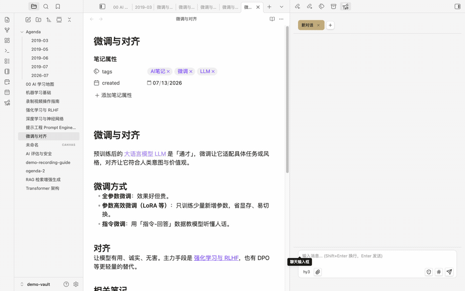
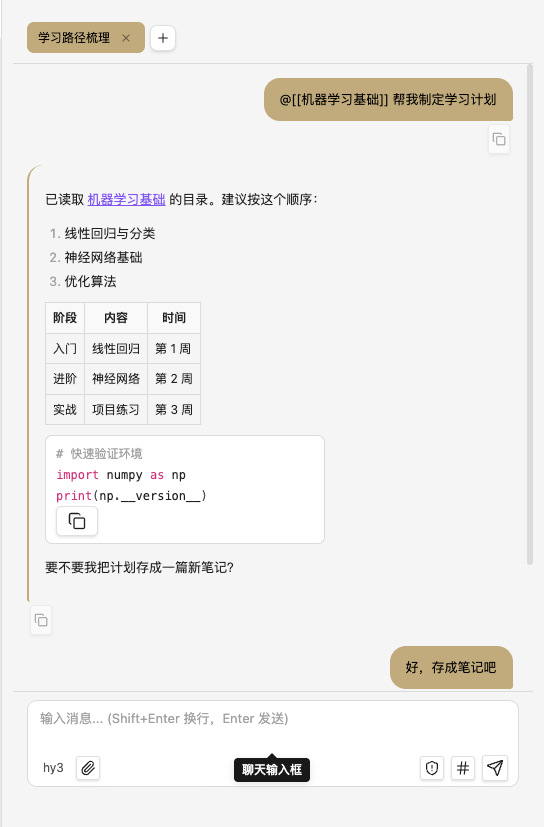
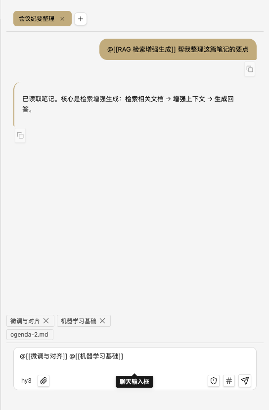

<h1 align="center">Workbuddian</h1>

<p align="center">
  <a href="https://github.com/jiang198012/workbuddian/releases/latest"></a>
  <a href="https://github.com/jiang198012/workbuddian/releases"></a>
  <a href="https://github.com/jiang198012/workbuddian/actions/workflows/ci.yml"></a>
  <a href="https://community.obsidian.md/plugins/workbuddian"></a>
  <a href="https://github.com/jiang198012/workbuddian/stargazers"></a>
  <a href="https://opensource.org/licenses/MIT"></a>
</p>

<p align="center">
  <strong>简体中文</strong> | <a href="./README.en.md">English</a>
</p>

<!--
project: Workbuddian
domain: Obsidian 插件 / AI 聊天 / 本地 AI agent / Hermes Agent / CodeBuddy CLI / WorkBuddy
audience: Obsidian 桌面端用户（Windows / macOS），中文为主
runtime: Obsidian 1.7.2+；CodeBuddy CLI、WorkBuddy 桌面端或 Hermes Agent
status: stable (2.6.23)
license: MIT
-->

**Workbuddian** 是一个 Obsidian 社区插件，把你本机的 AI agent 接进 Vault：**Hermes Agent**，或 **CodeBuddy CLI**（也可以直接用 **WorkBuddy** 桌面端自带的 CLI）。在笔记旁边对话、用 `@` 引用笔记和文件、在气泡里批准 agent 的每一步操作；它改过的文件以行级 diff 展示，对 Vault 内文件的局部编辑可以一键撤销。

> ⚠️ **仅桌面端**（Windows / macOS），需要 Obsidian 1.7.2+。Linux 暂不支持。

<p align="center">
  
</p>

<p align="center">
  
  
</p>

> **⭐ 觉得有用的话，欢迎 [Star 这个仓库](https://github.com/jiang198012/workbuddian)，让更多人发现它。**

## 功能亮点

| 能力 | 说明 |
| --- | --- |
| **两种后端** | **CodeBuddy CLI**（官方 CLI，或 WorkBuddy 桌面端内置的 CLI）与 **Hermes Agent**。两者都通过 ACP 运行，工具调用、批准卡、思考过程、上下文用量、会话分叉都可用。Hermes 在本机 CLI 不可用或使用远程 gateway 时，自动改用只能纯对话的轻量模式 |
| **流式对话** | 侧栏或主编辑区的全宽面板；思考过程和工具调用卡片可折叠；完整的 Markdown 渲染 |
| **`@` 引用** | 一条消息里同时带上笔记、任意文件、子代理和 MCP 服务器；笔记里选中的文字自动作为上下文 |
| **`/` 命令与 Skills** | 内置命令、提示词模板、已安装的 WorkBuddy / CodeBuddy Skills 和 Vault 里的自定义命令；其他 `/命令` 原样转给 CLI |
| **批准卡与权限模式** | 写文件、改文件、执行命令、调用 MCP 前在气泡里确认；可切换三种权限模式 |
| **行级 diff 与一键撤销** | 每次编辑显示改动的行；对 Vault 内文件的局部编辑可以一键撤销，有安全检查防止覆盖你之后的修改 |
| **内联编辑** | 选中文字后让 AI 就地改写，不离开笔记 |
| **会话管理** | 多标签、置顶、重命名、搜索、`/resume` 找回、分叉、两个面板各用各的会话、自动生成标题、导出为笔记 |
| **写回笔记** | 把回复或代码块插入当前笔记，或保存为新笔记 |
| **图片** | 粘贴或拖入截图，直接交给模型分析 |
| **模板与常驻指令** | 新建对话可选写作、翻译、代码审查、笔记整理等模板；`#` 常驻指令按会话保存 |
| **MCP 与子代理** | 可视化管理 MCP 服务器，列表和 JSON 双向同步；用 JSON 定义子代理 |
| **中英文界面** | 中文 / English 即时切换，默认跟随 Obsidian |

## 安装

**前置条件**：Obsidian 1.7.2+ 桌面版，Windows 或 macOS，并准备好一种后端（见[快速开始](#快速开始)）。

**从社区插件目录安装（推荐）**

1. Obsidian 里打开 **设置 → 第三方插件 → 浏览**。
2. 搜索 **Workbuddian**，点 **安装**，再点 **启用**。

也可以在网页上查看：[community.obsidian.md/plugins/workbuddian](https://community.obsidian.md/plugins/workbuddian)。

**用 BRAT 追踪最新版**：安装社区插件 BRAT，选 *Add Beta Plugin*，填 `jiang198012/workbuddian`，然后在 **设置 → 第三方插件** 里启用。

**手动安装**：从 [latest release](https://github.com/jiang198012/workbuddian/releases/latest) 下载 `main.js`、`manifest.json`、`styles.css`，放到 Vault 下的 `.obsidian/plugins/workbuddian/`，重启 Obsidian 后启用。

## 快速开始

### 选择后端

| 后端 | 适合 | 账号与额度 | 需要 |
| --- | --- | --- | --- |
| 官方 CodeBuddy CLI（推荐） | 想用 CodeBuddy 的完整能力 | 你自己的 CodeBuddy 账号 | Node.js |
| WorkBuddy 桌面端 | 已经在用 WorkBuddy，不想另装 CLI | 沿用桌面端登录的账号与额度 | 桌面端保持登录并运行 |
| Hermes Agent | 已在本机部署 Hermes Agent | Hermes 里配置的模型服务 | 本机 hermes CLI，或可访问的 Hermes gateway |

在 **设置 → Workbuddian → 后端连接 → 后端** 里选择 CodeBuddy 或 Hermes。前两种都属于 CodeBuddy 后端，区别只在用哪个 CLI。切换后端后需要重载插件才生效：按 Cmd/Ctrl + R 重新加载 Obsidian，或在第三方插件里关闭再启用 Workbuddian。

### 官方 CodeBuddy CLI

1. 安装 Node.js，然后安装 CLI：`npm i -g @tencent-ai/codebuddy-code`
2. 「CodeBuddy 路径」留空。插件会优先找到官方 CLI。
3. 在设置里点「CodeBuddy 登录」下的「登录 CodeBuddy」按钮，或在命令面板运行「登录 CodeBuddy」。浏览器会打开登录页（Chinese Site / iOA / 企业域名 / International Site），登录成功后插件自动重连并刷新模型列表，不需要在终端里登录。

### WorkBuddy 桌面端

1. 安装并登录 WorkBuddy 桌面端，保持它在运行。
2. 「CodeBuddy 路径」留空。没有装官方 CLI 时，插件自动使用 WorkBuddy 内置的 CLI，例如：
   - Windows：`C:\Program Files\WorkBuddy\resources\app.asar.unpacked\cli\bin\codebuddy`
   - macOS：`/Applications/WorkBuddy.app/Contents/Resources/app.asar.unpacked/cli/bin/codebuddy`

   WorkBuddy 装在其他目录时，在「CodeBuddy 路径」里填写这个文件的完整路径。
3. 不需要另装 Node.js，插件会使用 WorkBuddy 自带的运行时。内置 CLI 不支持一键登录，账号就是桌面端已登录的账号。

需要注意：

- 请正常打开 WorkBuddy，不要以管理员身份运行；否则插件连不上它，会提示 `E_SOCKET_FORBIDDEN`。
- 这条路依赖 WorkBuddy 的内部接口，WorkBuddy 升级后可能需要插件跟进适配（见 [Issue #10](https://github.com/jiang198012/workbuddian/issues/10)）。
- 走 WorkBuddy 原生账号通路时，回复可能在生成完后整段出现，而不是逐字显示。在 WorkBuddy 5.7.7 上测得单次请求约 50 秒、请求和响应约 640 KiB 的上限，很大的附件或很长的输出可能超限。

### Hermes Agent

1. 按 Hermes Agent 的官方说明在本机安装并配置好模型服务。
2. 后端选 **Hermes**。「Hermes CLI 路径」「Gateway 地址」「API Key」都可以留空：插件会依次在 `HERMES_HOME`、`%LOCALAPPDATA%\hermes`、`~/.hermes` 里读取 `config.yaml` 和 `.env`，自动找到 gateway 地址和 API Key。
3. 「运行模式」一行显示当前模式：
   - **ACP 完整版**：本机 hermes CLI 自检通过。工具调用、批准卡、思考过程、会话分叉都可用。gateway 没在运行时，插件会在后台启动 `hermes gateway run`。
   - **HTTP 轻量版**：只能纯对话。填了非本机的 gateway 地址，或本机 CLI 自检失败时使用，聊天面板顶部会显示提示条。

Windows 上的 Hermes 后端尚未在维护者的测试机上实机验证（自检、后台进程是否弹窗、`gateway.pid` 的位置等），详见 [CHANGELOG](CHANGELOG.md)。

### 发送第一条消息

1. 点左侧功能区的 Workbuddian 图标（小猪头像，提示「Workbuddian 聊天」），或在命令面板运行「打开聊天面板」。想要全宽面板，运行「在主编辑区打开大面板」。
2. 输入消息，**Enter** 发送，**Shift + Enter** 换行。
3. 模型列表加载后，可以在输入框工具栏切换模型。

## 使用方法

### 聊天面板

- **标签栏**：「新建对话」、「搜索会话」和会话标签。标签上的 × 只关闭标签，会话仍然保留。
- **输入框工具栏**：模型、📎 附件、「用模板新建」、权限模式（盾牌图标）、`#` 常驻指令、上下文用量环、发送 / 停止。
- 侧栏和主编辑区可以同时打开，各自绑定独立的会话，停止生成只影响当前面板。

### `@` 引用

输入 `@` 弹出下拉，可以选：

- 笔记：`@[[笔记名]]`，读取笔记正文作为上下文；
- 其他文件：作为附件交给 CLI 读取；
- 子代理：下拉里显示为 `@Agents/名称`；
- MCP 服务器：下拉里显示为 `@mcp/名称`；
- `@stats（Vault 统计）`：附上 Vault 的统计信息。

MCP 服务器在会话加载时确定（通常是会话的第一条消息）：这条消息里用 `@mcp/名称` 引用了服务器，这个会话就只加载被引用的服务器；没有引用时加载全部已启用的服务器。会话加载之后再引用，不会改变已加载的服务器。在笔记里选中的文字会自动作为只读上下文随消息发送。作为附件添加的 Vault 外文件，发送前会请你确认。

### `/` 命令与 Skills

输入 `/` 打开补全列表：

| 命令 | 作用 |
| --- | --- |
| `/clear` | 清空并新建对话（本地） |
| `/compact` | 压缩上下文 |
| `/context` | 查看上下文用量 |
| `/cost` | 查看本次花费 |
| `/effort` | 设置思考力度 |
| `/resume` | 恢复历史会话 |
| `/status` | 查看状态 |

此外还有：

- **Skills**：自动发现 `~/.workbuddy/skills`、`~/.codebuddy/skills`，以及 Vault 下 `.workbuddy/skills`、`.codebuddy/skills` 里的技能（同名时 Vault 级优先）。选中后填入 `/技能名`，接着写任务即可。插件只读取技能的名称和描述用于补全，不会把技能全文发给模型。
- **提示词模板**：`/translate`、`/summarize`、`/rewrite`、`/polish`、`/review`、`/explain`，选中后把预设提示填入输入框，改好再发送。
- **自定义命令**：Vault 下 `.codebuddy/commands/` 里的 Markdown 文件，子目录用 `:` 连接成命令名。
- **交给 CLI 的命令**：上表中标注「(CLI)」的 `/compact`、`/context`、`/cost`、`/status` 由 CLI 执行；补全里没有的 `/命令`，手动输入后会原样转给 CLI。

### 批准卡与权限模式

agent 写文件、改文件、执行命令或调用 MCP 前，会在气泡里弹出批准卡，可选「允许」「总是允许」「拒绝」。

点输入框工具栏的盾牌图标切换权限模式：

- **默认（每步询问）**：每一步都弹批准卡。
- **计划模式（只读不改）**：agent 先只读地出计划，显示「计划已就绪」卡，可选「按此执行」「总是执行」「取消」。选择执行后在同一轮里继续。
- **完全访问**：不再询问，直接执行。请只在信任当前任务时使用。

### 行级 diff 与一键撤销

每次编辑或写入完成后，工具卡片里显示结构化的 diff（默认折叠）。对 Vault 内文件的局部编辑可以一键撤销；整文件写入和纯删除没有撤销按钮。如果文件之后又被改过，或者替换位置不唯一，撤销会被拒绝并说明原因，避免覆盖你的修改。

### 内联编辑

在笔记里选中文字，按 **Ctrl/Cmd + Shift + E** 或右键选「Workbuddian编辑」，选区上方会出现浮动工具条，写下要求后就地改写。命令面板里还有「用 CodeBuddy 编辑选区」。

### 会话管理

- 标签右键：置顶会话、重命名、分叉当前会话（带上全部历史）、删除对话、导出为笔记、复制到剪贴板。删除前会提示消息条数且不可撤销。
- 关掉的会话可以用 `/resume` 或「搜索会话」找回。
- 首轮回复后自动为新会话生成标题；你手动改过的名字不会被覆盖。
- 命令面板：「新建对话」「搜索会话」「导出当前会话为笔记」「导出所有会话为笔记」。

### 回复写回笔记

- 用户消息：复制、编辑并重发。
- 助手回复：复制、插入回复、保存回复为笔记、重新生成。
- 代码块：复制代码、插入到当前笔记、保存为新笔记。

### 模板与常驻指令

- 「用模板新建」可选写作助手、翻译助手、代码审查、笔记整理，自动带上对应的常驻指令和开场白。
- 点工具栏的 `#`，或在命令面板运行「编辑常驻指令」，设置常驻指令或人设。常驻指令按会话保存，只对当前会话生效；同一个弹窗里还可以为这个会话单独开关「注入 Vault 上下文」「注入当前笔记链接」，会覆盖设置页里的全局开关。

### 图片与附件

粘贴的图片保存在插件目录里，以图片内容发送给模型；「粘贴图保留数量」控制最多留几张。拖入或用附件按钮添加的文件作为附件交给 CLI 读取：其中 Vault 内的图片同样以图片内容发送，Vault 外的文件发送前会请你确认。

## 设置

**设置 → Workbuddian**，按页面顺序：

| 分组 | 设置项 | 说明 | 默认 |
| --- | --- | --- | --- |
| 通用 | 界面语言 | Auto（跟随 Obsidian；Obsidian 没设语言时跟随系统）/ 中文 / English | Auto |
| 后端连接 | 后端 | CodeBuddy 或 Hermes | CodeBuddy |
| | 运行模式 | 仅 Hermes：显示 ACP 完整版或 HTTP 轻量版，检测中显示「正在检测运行模式…」 | — |
| | Hermes CLI 路径 | 仅 Hermes，留空自动发现 | 自动 |
| | Gateway 地址 | 仅 Hermes，在「高级」折叠区；留空自动发现；填非本机地址会使用轻量模式 | 自动 |
| | API Key | 仅 Hermes，在「高级」折叠区；本机 gateway 时以自动发现的值为准 | 自动 |
| | CodeBuddy 路径 | 仅 CodeBuddy，留空自动检测（优先官方 CLI） | 自动 |
| | CodeBuddy 登录 | 仅 CodeBuddy，官方 CLI 的浏览器一键登录 | — |
| | 手动指定 Node.js 路径 | 仅 CodeBuddy，自动探测失败时填写 | 自动 |
| | CLI 超时时长（分钟） | 单次回复最长等待时间，超时中断 | 5 |
| | 思考力度 | 对应 CLI 的 thought_level，按会话生效；`/effort` 的改动会同步回这里；Hermes 下不可用 | enabled |
| | MCP 服务器（JSON） | 可视化列表与 JSON 双向同步 | 空 |
| | 子代理（JSON） | 仅 CodeBuddy，对应 CLI 的 `--agents`，支持 tools / model 键 | 空 |
| 上下文注入 | 注入 Vault 上下文 | 每条消息附上当前 Vault 路径 | 开 |
| | 注入当前笔记链接 | 每条消息附上当前笔记的标题和路径（不含正文） | 关 |
| | 自动生成会话标题 | 首轮回复后由 AI 命名新会话 | 开 |
| | 粘贴图保留数量 | 插件目录里最多保留的粘贴图片，0 表示不限制 | 20 |
| | 输入框自动调整高度 | 随内容自动伸缩，并可设最小 / 最大高度（像素） | 开（30–200） |
| 外观 | 聊天主色调 | 自定义强调色，可恢复为跟随 Obsidian 主题色 | 跟随主题 |
| | 上下文窗口上限（token） | 上下文用量百分比的分母，按模型窗口调整 | 200000 |
| 重置 | 重置为默认 | 清空自定义设置，恢复默认值 | — |
| 导入 / 导出设置 | 导出设置 / 导入设置 | 用 JSON 文件备份、迁移设置；导出的文件含明文的 Hermes API Key，请妥善保管 | — |
| 日志 | 查看日志 | 打开 `[WB]` 运行日志，排查问题用 | — |
| CodeBuddy 插件 | | 浏览和管理 CodeBuddy 插件 | — |

模型和权限模式不在设置页，而在聊天输入框的工具栏里。

### 命令面板

| 命令 | 作用 |
| --- | --- |
| 打开聊天面板 | 在侧栏打开聊天 |
| 在主编辑区打开大面板 | 在主编辑区打开全宽聊天 |
| 新建对话 | 新建一个会话 |
| 搜索会话 | 按标题搜索历史会话 |
| 导出当前会话为笔记 | 把当前会话保存为 Markdown 笔记 |
| 导出所有会话为笔记 | 一次导出全部会话 |
| 编辑常驻指令 | 设置当前会话的常驻指令 |
| 打开 Workbuddian 设置 | 打开设置页 |
| 登录 CodeBuddy | 官方 CLI 的浏览器一键登录 |
| 用 CodeBuddy 编辑选区 | 用选中文字发起编辑 |
| Workbuddian编辑 | 选区上方的浮动编辑工具条（Ctrl/Cmd + Shift + E） |
| 安装 WorkBuddy 本地连接扩展 | 通常不需要，见[安全与权限](#安全与权限) |

## 自动发现

**CodeBuddy CLI**（「CodeBuddy 路径」留空时）：

1. 环境变量 `CODEBUDDY_PATH`；
2. 官方 CodeBuddy CLI：
   - Windows：`%AppData%\npm\codebuddy.cmd`、`%ProgramFiles%\nodejs` 下的 `codebuddy.cmd`；
   - macOS：`~/.local/bin`、`~/.npm-global/bin`、`~/.volta/bin`、`~/bin`、`/usr/local/bin`、`/opt/homebrew/bin`、nvm / npm 前缀目录；
   - 以上都没有时查 `PATH`；
3. WorkBuddy 内置 CLI：
   - Windows：`%LocalAppData%\Programs\WorkBuddy`、`%ProgramFiles%\WorkBuddy`、`%ProgramFiles(x86)%\WorkBuddy`，以及 C / D / E 盘 `Program Files` 和 `Program Files (x86)` 下的 WorkBuddy；
   - macOS：`/Applications/WorkBuddy.app`、`~/Applications/WorkBuddy.app`；
   - 都没有时查 `PATH`。

手动填写的路径和 `CODEBUDDY_PATH` 原样使用，失效时不会自动换成别的 CLI。

**Hermes**：

- 配置：依次在 `HERMES_HOME`、`%LOCALAPPDATA%\hermes`、`~/.hermes` 读取 `config.yaml` 和 `.env`，得到 gateway 地址和 API Key；两个文件都有时以 `.env` 为准。
- CLI：`~/.local/bin/hermes`、`~/.hermes/bin/hermes`（Windows 为 `.exe`），macOS 另查 `/usr/local/bin`、`/opt/homebrew/bin`，最后查 `PATH`（Windows 也接受 `hermes.cmd`）。Hermes 官方安装器把 CLI 放在其他目录且不在 `PATH` 中时，请在「Hermes CLI 路径」里填写。

**Node.js**（仅官方 CLI 等需要 Node 的情况）：

- Windows：`%ProgramFiles%\nodejs`、`%AppData%\npm`、`%LocalAppData%\Programs\nodejs`、nvm-windows，以及 WorkBuddy 自带的 `~/.workbuddy/binaries/node/versions/*`；
- macOS：`~/.local/bin`、`~/.npm-global/bin`、`~/.volta/bin`、`~/bin`、`/usr/local/bin`、`/opt/homebrew/bin`、nvm；
- 都找不到时，在「手动指定 Node.js 路径」里填写。

## 安全与权限

Workbuddian 会让本机的 AI agent 读写文件、执行命令，下面说明它能做什么、你怎么控制。

**会访问什么**

- 运行你本机的 CodeBuddy CLI、WorkBuddy 内置 CLI 或 hermes CLI，并在需要时启动 Hermes gateway。
- 读取文件通常不弹批准卡：CLI 默认放行读取，包括 Vault 外的路径。写入、编辑、执行命令、调用 MCP 前，需要你在批准卡上确认。
- 走 WorkBuddy 桌面端时，通过 WorkBuddy 的本地接口使用它已登录的账号。插件不读取、不复制、不解密 WorkBuddy 的登录凭据。

**什么时候会联网或在后台运行**

- Obsidian 加载插件时就会启动后端进程，用来获取模型列表；插件不会发送用于预热的对话。
- Hermes：gateway 没在运行时，插件在后台启动 `hermes gateway run`，Obsidian 退出后它会继续运行。
- WorkBuddy 桌面端：需要时插件会自动打开 WorkBuddy。
- 开启「自动生成会话标题」后，首轮回复结束时会额外请求一次标题。
- 「安装 WorkBuddy 本地连接扩展」命令会在你确认后，把一个组件写入 `<WorkBuddy 配置目录>/extensions/workbuddian-warmup`，随 WorkBuddy 常驻，只用于唤起 WorkBuddy 的本地任务服务。从 2.6.14 起通常不需要它，插件也不会自动安装。

**怎么授权**

- 写文件、改文件、执行命令、调用 MCP 都要在批准卡上确认，除非你切到「完全访问」。
- 作为附件添加的 Vault 外文件，发送前需要你确认；agent 自己用工具读取文件不经过这道确认。

**怎么控制**

- 关闭「注入 Vault 上下文」和「注入当前笔记链接」（在 `#` 弹窗里单独设置过的会话，以会话设置为准）。
- 用权限模式控制 agent 能做什么。
- 在「查看日志」里查看 `[WB]` 日志，确认插件做了什么。

## 故障排查

**提示「CodeBuddy 未登录」？**
官方 CLI：在设置里点「登录 CodeBuddy」完成浏览器登录。WorkBuddy 内置 CLI：确认桌面端已登录并在运行；这条路不支持一键登录。

**只装了 WorkBuddy 桌面端，检测不到 CLI？**
WorkBuddy 装在默认目录以外时，在「CodeBuddy 路径」里填 `<安装目录>\resources\app.asar.unpacked\cli\bin\codebuddy`（macOS 为 `.app/Contents/Resources/...`）。

**提示 `E_SOCKET_FORBIDDEN`，或 WorkBuddy 本地代理拒绝连接？**
WorkBuddy 很可能以管理员身份运行，而 Obsidian 不是。完全退出 WorkBuddy（包括托盘图标），再正常打开。

**Hermes 一直是轻量模式？**
先看设置里「运行模式」的提示：远程 gateway 地址只能用轻量模式；本机 CLI 自检失败时，检查「Hermes CLI 路径」，在终端运行 `hermes acp --check` 确认能通过。改完设置后插件会重新检测。

**找不到 Node.js？**
只有官方 CLI 等需要 Node 的情况才会遇到。安装 Node.js，或在「手动指定 Node.js 路径」里填 node 的完整路径。走 WorkBuddy 内置 CLI 时不需要 Node。

**回复显示「本轮中断：refusal（…）」？**
括号里是服务端给出的原因（例如额度、模型不可用）。按原因处理；如果怀疑是插件问题，请带上 `[WB]` 日志提 issue。

**发消息后一直没有回复？**
先点「重试」。CLI 进程意外退出时，下次发送会自动重启并恢复会话上下文。仍不行时打开「查看日志」查看 `[WB]` 日志。

**Linux 能用吗？**
暂不支持，只支持 Windows / macOS 桌面端。

## 最新版本

**2.6.23**：聊天面板更易读（正文跟随 Obsidian 字号、助手回复去掉气泡、思考和工具调用折叠成一行摘要）；`@` 下拉选择 MCP 服务器现在能按引用加载；设置页与提示文案和当前行为一致；中英文 README 全面重写。

完整的版本记录见 [CHANGELOG.md](CHANGELOG.md)。

## 开发

```bash
npm install    # 安装依赖
npm run dev    # 开发构建（esbuild watch）
npm run build  # 生产构建（tsc 类型检查 + esbuild 打包）
npm test       # 运行测试（jest）
```

`scripts/e2e/` 用 Playwright 通过 CDP 驱动真实的 Obsidian，覆盖插件加载、打开面板、发送消息、流式回复和双面板回归。

## 相关项目

- **CodeBuddy / WorkBuddy**：本插件 CodeBuddy 后端所用的 CLI。
- **Hermes Agent**：本插件 Hermes 后端所用的 agent。
- **Claudian**（MIT）：在 Obsidian 里使用 Claude Code 的同类插件，Workbuddian 的界面参考了它的设计模式（没有拷贝代码）。
- **BuddyBridge**（MIT）：早期版本的部分基础代码曾参考或使用它的实现，当前版本已独立重构。

版权与来源见 [LICENSE](LICENSE) 和 [NOTICE](NOTICE)。

## 支持

提交 bug 或功能请求：[GitHub Issues](https://github.com/jiang198012/workbuddian/issues)。提交前请先看上面的故障排查，并附上 `[WB]` 日志（注意脱敏）。

## License

MIT，见 [LICENSE](LICENSE)。
