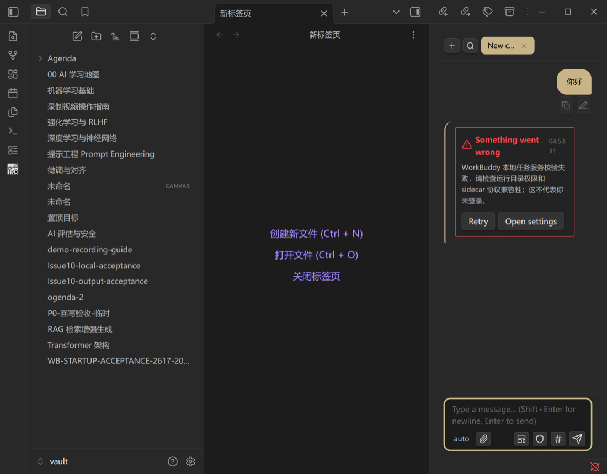
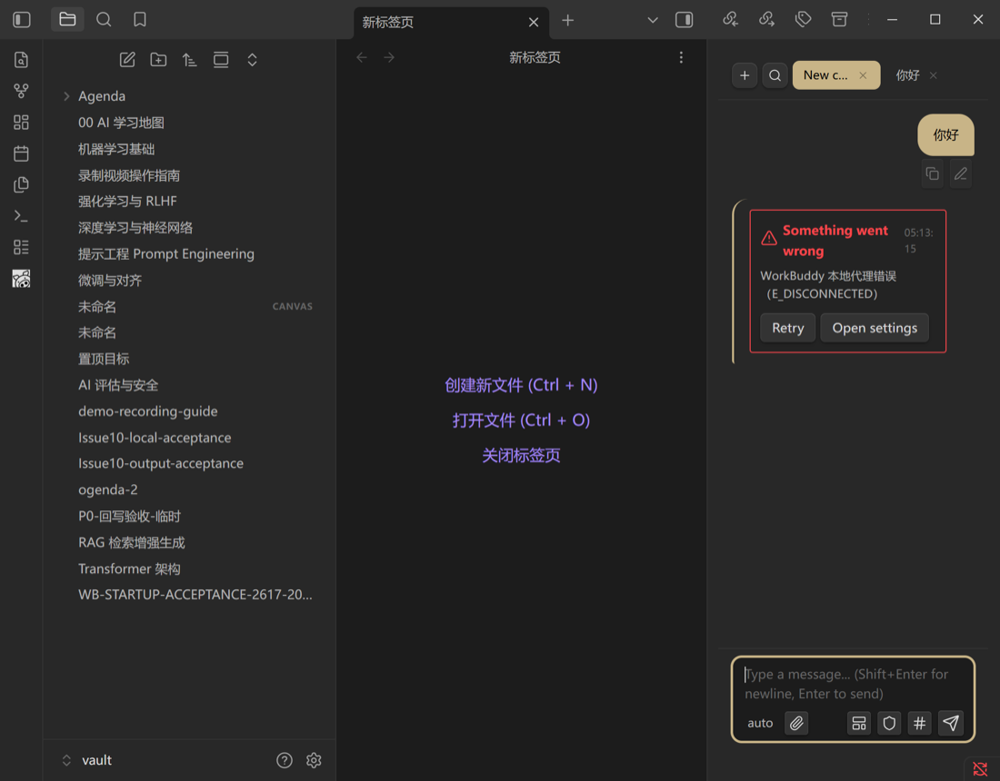
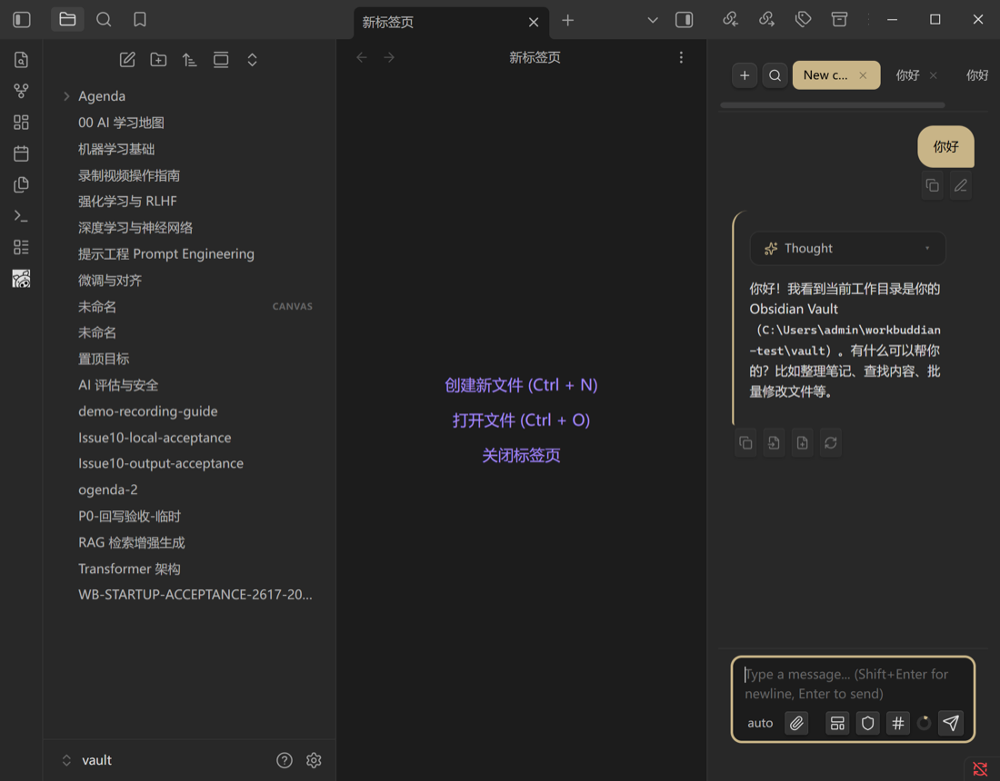
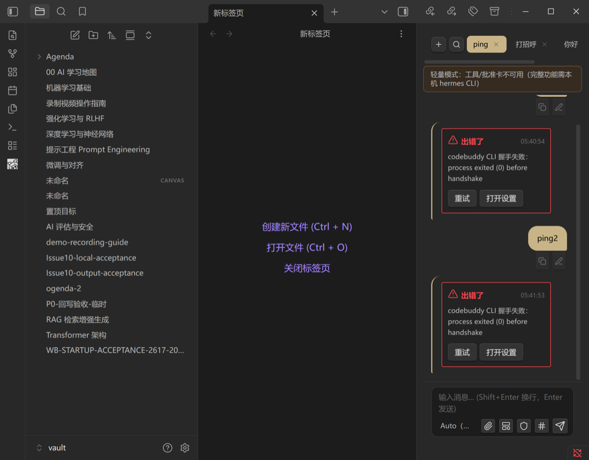
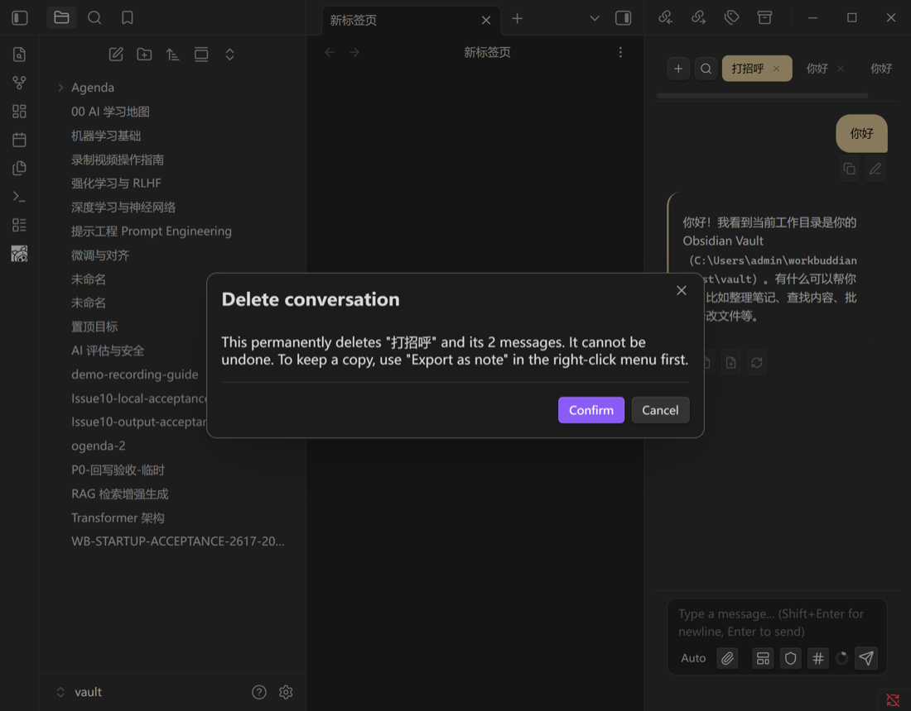
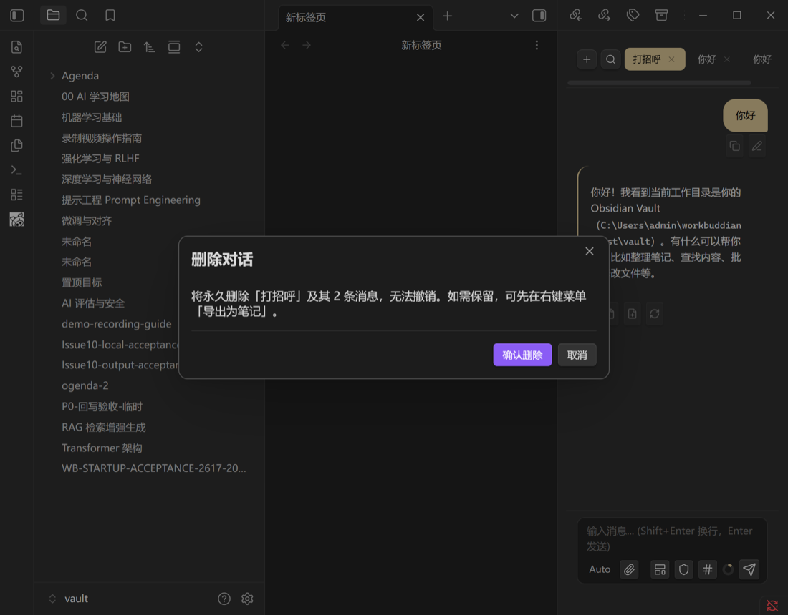

# Workbuddian 2.6.21：Windows 实机验证报告（#19 / #14 / #15 / #13 / #16）

## 结论

| 项 | 内容 | 结果 |
|---|---|---|
| #19a | 只装 WorkBuddy 桌面端时自动检测内置 CLI | **PASS**：探测列表原本就覆盖 `C:\Program Files\WorkBuddy`，实机与 Obsidian 内均检测到；补了一条按实机布局的回归测试 |
| #19b | 2.6.21 的 401 修复，对话能否正常回复 | **已修复并通过**：实机先后暴露两个问题——残留旧版 `sidecar.pid` 被误判为「校验失败」（代码已修），以及 WorkBuddy 以管理员身份运行导致 `EPERM`（环境问题，按普通权限重启 WorkBuddy 后解决）；最终构建发「你好」正常回复 |
| #14 | Windows 上 codebuddy 后端返回 refusal | **WorkBuddy 5.11.3 未复现**：同一条原生账号通路正常回复，界面无错误；5.9.3 不在测试机上，未验证 |
| #15 | 初始化期间误报「轻量模式」顶条 | **已修复并通过**：单测覆盖；Windows 实机上初始化 22 秒内顶条保持隐藏，落定为 HTTP 后正常显示 |
| #15 | ACP 主进程 `windowsHide`（黑窗口） | **未验证**：未装 Hermes；用桩脚本做对照时，不加 `windowsHide` 也看不到窗口，无法区分（见下文） |
| #15 | `gateway.pid` 在 Windows 上的位置 | **未验证**：测试机未装 Hermes |
| #13 | Windows `.cmd` 自检（`spawn EINVAL`） | **桩脚本通过，真实 Hermes 未验证**：Obsidian 内 `execFile` 调 `hermes.cmd acp --check` 成功，路由定为 ACP |
| #16 | 右键删除确认框新文案 | **PASS**：中英文均截图确认 |

## 测试基线与方法

| 项目 | 实际值 |
|---|---|
| 测试日期 | 2026-11-22（日志时间为测试机本地时间） |
| 测试机 | Windows 11 Pro，JHF-HUAWEI，账户 `admin`，经 Tailscale + SSH（仅密钥）连接 |
| Obsidian | 1.13.7（Electron 43.3.0 / Chrome 150） |
| WorkBuddy | 桌面端 5.11.3，安装在 `C:\Program Files\WorkBuddy`；内置 CLI `@genie/agent-cli` 2.176.0；未装官方 CodeBuddy CLI |
| Node | 系统 Node 24.14.1（`C:\Program Files\nodejs`）；WorkBuddy 自带 Node 22.22.2 |
| Hermes | 未安装（`%LOCALAPPDATA%\hermes`、`~/.hermes` 都不存在） |
| 测试库 | `C:\Users\admin\workbuddian-test\vault`，由仓库 `demo-vault` 的笔记复制，`.obsidian` 新建，只启用 workbuddian，无 `data.json`（验证留空自动检测） |
| 代码基线 | `3c68727`（2.6.21 之后）+ 本次本地修改 |

插件 `main.js`（SHA-256）：

```text
dc79d50046457e2b1fbde00c14ae9e5bb3229a1647c7e56b9394894fdc87ab3f  基线 3c68727 构建（首轮失败）
71322eaf14c607ae964430a6dc155d996905b955ffb0b25be90dc61a0b692cef  加 sidecar 修复（#19b 首次通过）
d42c621d8b38708c9824294c663e69e058ac44b000a830935b0d54d483f09a70  最终构建（含 #15 顶条修复，最终复测通过）
```

方法：

- 图形程序用一次性交互式计划任务在会话 1 启动；Obsidian 带 `--remote-debugging-port=9222`（只绑 127.0.0.1），经 `ssh -L` 转发后用 DevTools 协议读 DOM、截图、读 `[WB]` 日志、重载插件。
- Obsidian 1.13 的设置页开在独立弹出窗口，「查看日志」弹窗也开在那个窗口里，需从 `app.setting.popout.win.document` 读取。
- 在会话 1 用 `CopyFromScreen` 截桌面，结果全黑（控制台会话画面没在渲染），这个办法在这台机器上不可用；可见窗口改用 `EnumWindows` + `IsWindowVisible` 枚举。
- Windows 11 默认终端是 Windows Terminal，计划任务直接跑 `cmd.exe`/`powershell.exe` 会在桌面弹出终端窗口；后来改用 `wscript` 隐藏执行。

## #19a：内置 CLI 自动检测

- 实机路径：`C:\Program Files\WorkBuddy\resources\app.asar.unpacked\cli\bin\codebuddy`（小写 `resources`，入口无扩展名，`product.json` 的 `productName` 为 `WorkBuddy`）。
- `src/utils/cliPath.ts` 的 Windows 候选里本来就有 `%ProgramFiles%\WorkBuddy\Resources\...\codebuddy`；NTFS 不区分大小写，所以已覆盖。
- 证据一：把 `cliPath.ts` 单独打包，在测试机上用 Node 运行：

  ```text
  RESOLVED=C:\Program Files\WorkBuddy\Resources\app.asar.unpacked\cli\bin\codebuddy
  BUNDLED=true
  OFFICIAL=false
  NODE=C:\Program Files\nodejs\node.exe
  ```

- 证据二：Obsidian 内 CLI 路径留空，日志：

  ```text
  [04:51:15] [WB] resolved WorkBuddy bundled codebuddy path: C:\Program Files\WorkBuddy\Resources\app.asar.unpacked\cli\bin\codebuddy
  ```

- 新增回归测试 `tests/cliPath.test.ts`「detects the WorkBuddy 5.11.3 desktop-only layout in Program Files (#19)」，按实机布局和大小写不敏感的文件系统断言能检测到。
- 注册表卸载项 `InstallLocation` 为空，只有 `DisplayIcon`（`C:\Program Files\WorkBuddy\WorkBuddy.exe,0`）。#19 报告者的实际安装路径仍未知，若装在自定义目录，现有列表仍检测不到。

## #19b：对话能否正常回复

### 问题 1：残留旧版 `sidecar.pid` 被误判为「校验失败」（已修复）



- 现象：发「你好」，返回「WorkBuddy 本地任务服务校验失败，请检查运行目录权限和 sidecar 协议兼容性；这不代表你未登录。」
- 在 Obsidian 进程内逐步复现 `locate()`：

  ```text
  runtimeDir  C:\Users\admin\AppData\Local\Temp\wb\94d003d1c459
  sidecar.pid keys=[pid, token, version]  pid=26884  version=3  （无 controlPipeUuid）
  kill(26884, 0) → ESRCH
  ```

- 文件创建于 11-21 22:16，最后修改于 11-22 01:40:06；当时运行的 WorkBuddy 于 01:41:21 启动，进程 26884 早已退出。WorkBuddy 5.11.3 自己遇到这种文件时，按 `legacy pre-uuid PID file detected, forcing recovery` 清理。
- 根因：`readIdentity()` 先校验 `version === 6` 和 `controlPipeUuid`，不符就抛出不带错误码的异常，`locate()` 把它归为「校验失败」，没有走「sidecar 不在 → 预热 → 原生通路」的回退。
- 修复（`src/providers/codebuddy/workbuddySidecar.ts`）：`locate()` 先探测 PID 是否存活，进程已退出就按 `ESRCH`（宿主未运行）处理；进程存活而版本不符时照旧报「校验失败」。清理用的 `open()` 重连路径不变。
- 新增测试 `tests/workbuddySidecar.test.ts`「treats a legacy PID file whose sidecar has exited as a stopped host, not invalid metadata」：修复前失败（报「校验失败」），修复后通过。原有「进程存活但版本为 7 时报校验失败」的测试保持通过。
- 测试机上的残留 `sidecar.pid` 未改动。

### 问题 2：WorkBuddy 以管理员身份运行，Obsidian 连不上 wbipc 管道（环境问题）



- 现象：越过问题 1 后，返回「WorkBuddy 本地代理错误（E_DISCONNECTED）」。
- 在 Obsidian 进程内手动连 `endpoint.json` 里的管道：

  ```text
  endpoint  \\.\pipe\wbipc-d46d7c3e00796171   （endpoint.json 只有 endpoint、ticket 两个字段，ticket 43 位）
  +1ms error code=EPERM msg=connect EPERM \\.\pipe\wbipc-d46d7c3e00796171
  ```

- 进程令牌：WorkBuddy 全部进程 `il=0x3000 elevated=1`（High，已提权）；Obsidian `il=0x2000 elevated=0`（Medium）。普通权限进程打不开提权进程建的命名管道。
- `WorkBuddy.exe` 的清单是 `asInvoker`，正常启动应是普通权限。这次的父进程是 `DllHost.exe /Processid:{A9D4F7E2-C8B3-4D5E-9A1F-3E7C6B8D4F2A}`，该 CLSID 在注册表里查不到。推测是自动更新后带着管理员权限重启的，未确证。
- 处理：经用户同意，在会话 1 重启 WorkBuddy。WorkBuddy 常驻托盘，`taskkill`（不带 `/f`）无效；确认空闲（5 秒内 CPU 约 0）后结束进程树，再经 `explorer.exe` 以普通权限启动。重启后全部进程 `il=0x2000 elevated=0`，`endpoint.json` 更新。

### 结果



```text
[05:33:35] [WB] acp 请求: initialize {"protocolVersion":1,...}
[05:33:35] [WB] acp 请求: session/load {"sessionId":"7ec8ad5d-...","cwd":"C:\\Users\\admin\\workbuddian-test\\vault","mcpServers":[]}
[05:33:35] [WB] acp 请求: session/prompt {"sessionId":"7ec8ad5d-...","prompt":"<1 blocks, 104 chars>"}
[05:33:43] [WB] acp 请求: session/prompt {"sessionId":"1e2bcae2-...","prompt":"<1 blocks, 111 chars>"}   ← 自动标题
```

- 回复：「你好！我看到当前工作目录是你的 Obsidian Vault（C:\Users\admin\workbuddian-test\vault）。有什么可以帮你的？……」，约 10 秒；自动标题为「打招呼」。
- 原生 worker 连接时带网关密码，未出现 `HTTP 401`。
- 模型目录：WorkBuddy 正常运行后加载 15 个模型（Auto、Hy4、GLM-5.3、Kimi-K3.1-Pro 等）；此前两轮的「模型目录加载失败」与上面两个问题同因。
- 最终构建（`d42c621d…`）复测：「你好」约 7 秒正常回复。
- 共发送 4 次「你好」：前 2 次分别失败在 worker 创建前和账号代理连接时，没有到达账号；到达账号的是 2 条「你好」和插件自动标题请求 2 次。另有 2 条消息发给 Hermes 桩脚本，未出网。

## #14：refusal

- 在 WorkBuddy 5.11.3 + 当前代码下，codebuddy 后端走的是 #14 描述的同一条通路（worker → wbipc 账号代理 → 桌面端 → 云端）。两次「你好」都正常回复，界面无错误气泡。插件只有 `stopReason === 'end_turn'` 时才正常收尾，其他原因都会显示「本轮失败」，所以这两轮都不是 `refusal`。
- 结论：**5.11.3 未复现**。报告者用的是 5.9.3，测试机上没有这个版本，未验证；降级需下载安装，本次未做。
- #14 的建议「把 refusal 的服务端原因透出到聊天面板」本次未处理，列为后续项。

## #15：初始化期间误报「轻量模式」顶条（已修复）

- 根因：`HermesProvider` 的 `modeValue` 在 init 落定前是占位值 `'http'`，顶条按它判断。
- 修复：
  - `src/providers/hermes/index.ts`：新增 `liteConfirmed`，只有探测落定且模式为 `http` 时才为真；探测开始、落定都会通知 `onModeChange`。落定为 `http` 时 mode 值没变，原来不会触发回调，现在也会。配置变更后的新一轮探测用代数判断，只认最新一轮。
  - `src/features/chat/view.ts`：顶条改看 `liteConfirmed`。
- 新增 2 项单测（`tests/hermesRouter.test.ts`）：探测中不算轻量、落定为 ACP 不算；落定为 HTTP 时确认并通知。
- Windows 实机（Hermes CLI 指向桩脚本，gateway 自启等待 20 秒）：

  ```text
  1s  mode=http settled=false banner=hidden
  …
  22s mode=http settled=false banner=hidden
  23s mode=acp  settled=false banner=hidden    ← 落定为 ACP
  ```

- 反向检查：CLI 指向不存在的路径，落定为 HTTP 后顶条正常显示：

  ```text
  22s mode=http settled=false banner=hidden
  23s mode=http settled=true  banner=SHOWN:轻量模式：工具/批准卡不可用（完整功能需本机 hermes CLI）
  ```

  

- 设置页「运行模式」一行在探测期间仍显示「HTTP 轻量版 · 未检测到 hermes CLI」，本次没改，列为后续项。

## #13 / #15 的 Windows 项（未装 Hermes）

按约定不安装 Hermes。用桩脚本 `hermes.cmd` 做了两项调用方式的检查：`acp --check` 输出 OK 并退出 0，`acp` 时挂起 30 秒。脚本放在测试目录，用完已删。

- **#13 `.cmd` 自检**：Obsidian 内 `execFile(hermes.cmd, ['acp','--check'], { shell: true, windowsHide: true })` 成功，日志 `[WB] hermes 路由: acp (C:\Users\admin\workbuddian-test\hermes-stub\hermes.cmd)`，没有 `spawn EINVAL`。真实 Hermes 的自检耗时、`HERMES_HOME` 发现均未验证。
- **#15 黑窗口：未验证**。
  - 插件启动 ACP 时，进程链为 `cmd.exe /d /s /c "...\hermes.cmd acp"` → `conhost.exe 0x4` + `PING.EXE`，会话 1 里没有新增可见窗口（无 `ConsoleWindowClass`，也无 Windows Terminal 的 `CASCADIA_HOSTING_WINDOW_CLASS`）。
  - 对照组：在 Obsidian 进程里不加 `windowsHide` 启动同一脚本，同样枚举不到可见窗口。Obsidian 改经快捷方式由 `explorer.exe` 启动后重做对照，结果相同。
  - 检测方法区分不了加与不加 `windowsHide`，所以不能据此下结论，原因未查明。
- **#15 `gateway.pid` 位置：未验证**（没有 Hermes gateway 进程）。

## #16：右键删除确认框





- 右键菜单：置顶会话 / 重命名 / 分叉当前会话 / 删除对话 / 导出为笔记 / 复制到剪贴板。
- 中文：「删除对话 — 将永久删除「打招呼」及其 2 条消息，无法撤销。如需保留，可先在右键菜单「导出为笔记」。」按钮「确认删除 / 取消」。
- 英文：「Delete conversation — This permanently deletes "打招呼" and its 2 messages. It cannot be undone. To keep a copy, use "Export as note" in the right-click menu first.」按钮「Confirm / Cancel」。
- 两次都点了取消，会话未删除。

## 代码改动与回归

| 文件 | 改动 |
|---|---|
| `src/providers/codebuddy/workbuddySidecar.ts` | 先探测 PID 存活再校验版本，残留旧版 pid 文件按宿主未运行处理 |
| `src/providers/hermes/index.ts` | 新增 `liteConfirmed`，探测落定状态变化时通知 |
| `src/features/chat/view.ts` | 顶条改看 `liteConfirmed` |
| `tests/workbuddySidecar.test.ts`、`tests/hermesRouter.test.ts`、`tests/cliPath.test.ts` | 新增 4 项测试 |
| `main.js` | 重新构建 |

- `npm test`：56 套件、796 项通过，0 失败。
- `npm run build`：类型检查与生产构建通过。

## 后续项（本次未处理）

1. **管理员权限运行的 WorkBuddy 报错不明确**：Windows 上连接 wbipc 管道遇到 `EPERM` 时只显示 `E_DISCONNECTED`。建议单独归类，提示「WorkBuddy 以管理员身份运行，请正常重新打开」。
2. **界面语言「自动」在 Windows 上退回英文**：Obsidian 1.13.7 界面为中文时，`localStorage.language` 为空（`navigator.language=zh-CN`、`<html lang="zh">`、`moment.locale()=zh-cn`），`src/i18n/index.ts` 只看 `localStorage`，结果显示英文。
3. **Hermes 后端的握手失败文案写成「codebuddy CLI 握手失败」**（见上方 06 号截图）。
4. **#14 建议**：把 `refusal` 时的 `codebuddy.ai/errorMessage` 透出到聊天面板。
5. **#15 设置页**：探测期间「运行模式」一行仍显示 HTTP 轻量与「未检测到 hermes CLI」。
6. **#19 自定义安装目录**：如需覆盖，可读卸载项 `DisplayIcon` 推出安装目录，需报告者的实际路径确认。

## 测试机状态

- Obsidian 已恢复为打开 EA（`C:\obsidian\EA`），正常启动，无调试端口；EA 里的 workbuddian（2.3.1）未改动。
- 测试库仍在 Obsidian 库列表中（未打开）；原库列表备份在 `C:\Users\admin\workbuddian-test\obsidian.json.orig`。
- `C:\Users\admin\workbuddian-test` 保留 `vault`、`scripts`、`detect.cjs`；桩脚本、调试快捷方式、截屏和枚举临时文件已删除。
- WorkBuddy 现以普通权限运行。计划任务 `WB-Test-*` 均已注销；`AI4CAD-Revit` 未动。测试期间 Revit 2025 一直开着，不是本次启动的，未触碰。
